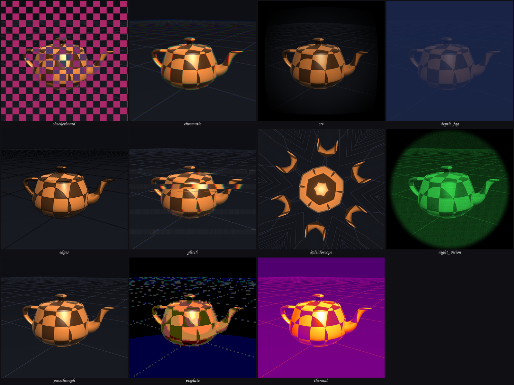
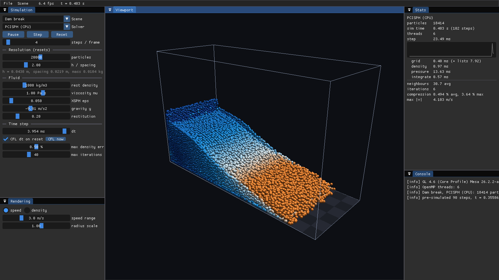
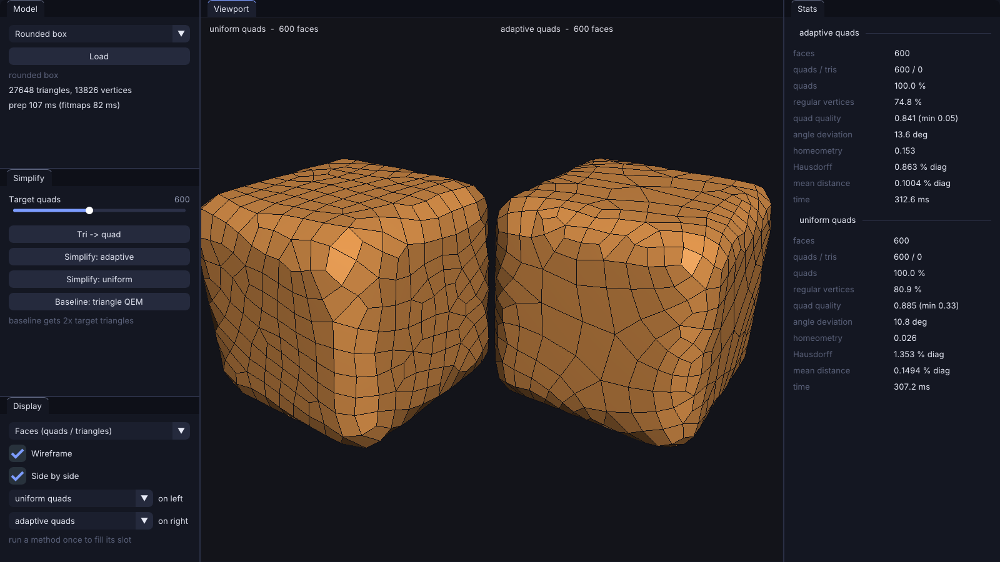
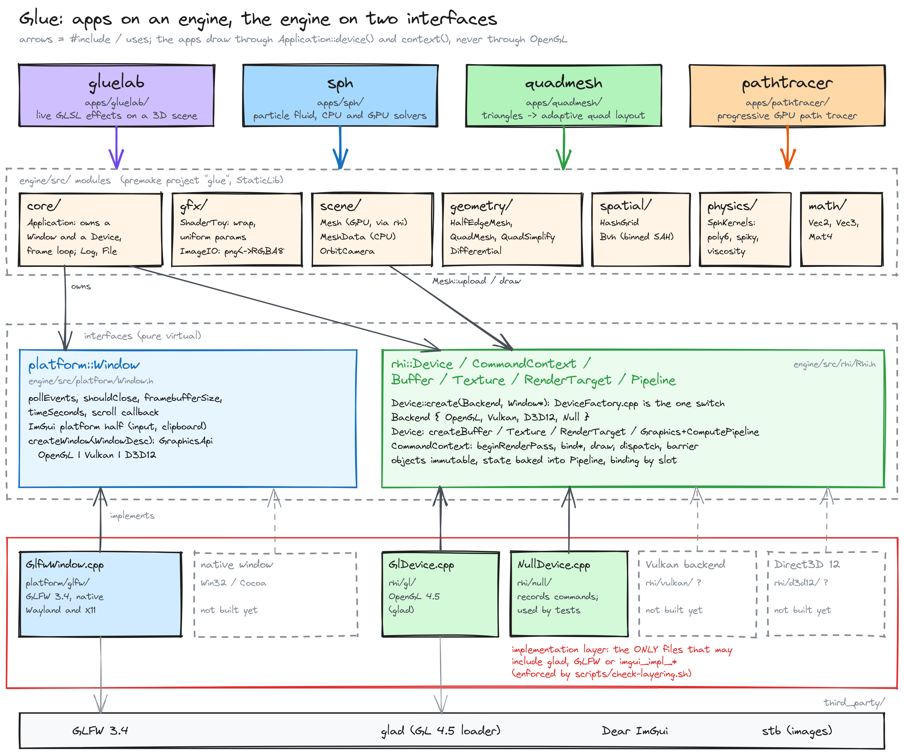
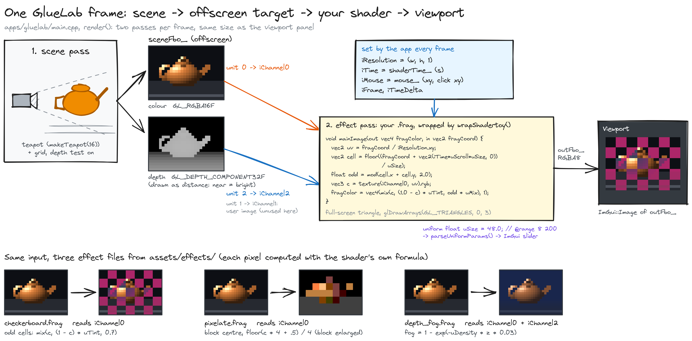
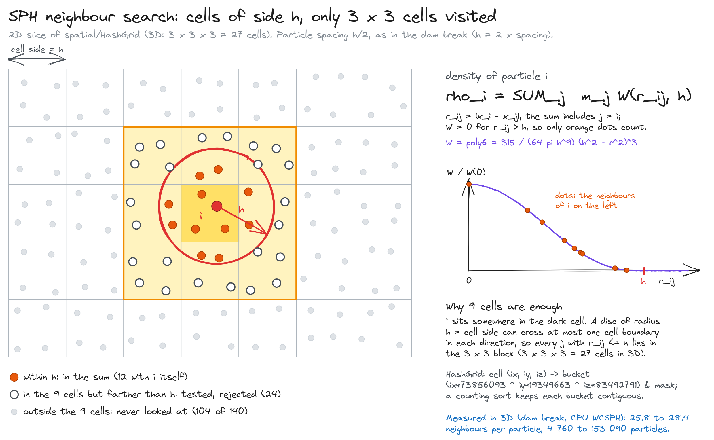
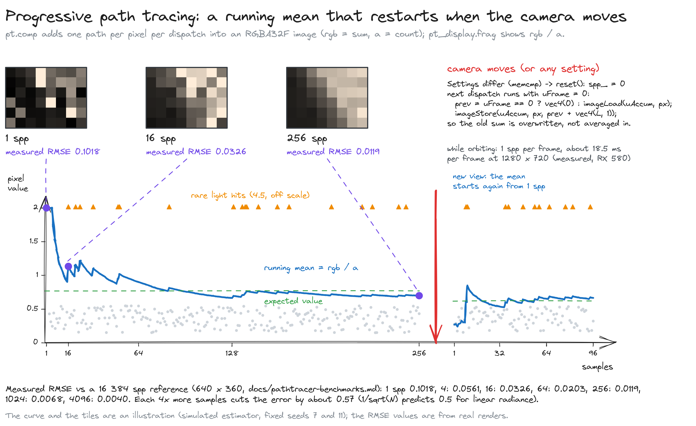
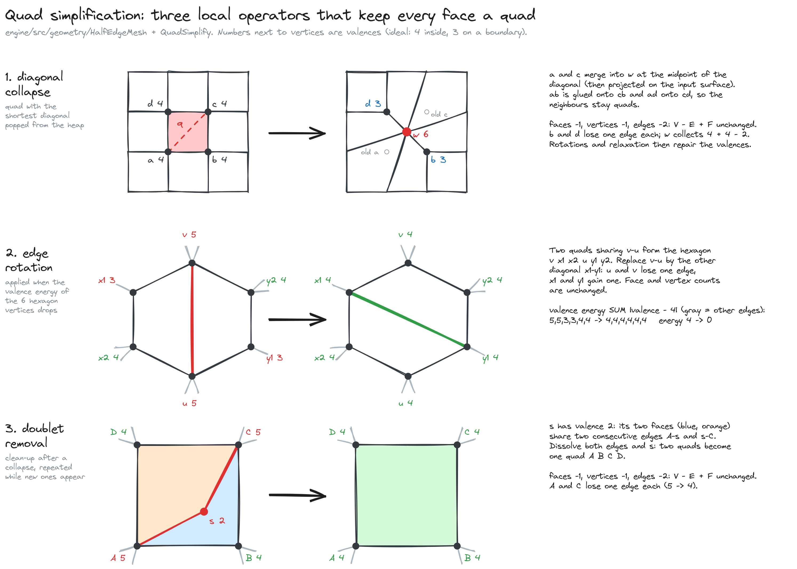

# Glue

[](https://github.com/mbenimam/Glue/actions/workflows/build.yml)


**A small OpenGL engine written from scratch, and four real-time graphics apps built on it: a Shadertoy-style shader lab, an SPH fluid simulator, an adaptive quad-mesh simplifier and an interactive GPU path tracer.**

C++20 · OpenGL 4.5 · Premake5 · Dear ImGui · Linux (Wayland and X11) · MIT



*Eleven fragment-shader effects (glitch, night vision, checkerboard, CRT, thermal, kaleidoscope, depth fog...) on the Utah teapot, tessellated from its 32 Bezier patches inside the engine. Every effect is one editable `.frag` file.*

## At a glance

| | |
|---|---|
| **What** | One engine, four apps. The geometry, the spatial structures, the SPH kernels and the BVH are written here, not pulled from a library (no GLM, no Eigen, no libigl). |
| **Hardest parts** | A compute-shader path tracer that keeps accumulating samples while you orbit the camera; an incompressible SPH solver (PCISPH); a half-edge mesh with a quad simplifier driven by curvature "fitmaps". |
| **Measured** | Path tracer: 427 MRays/s at 1280x720 on an RX 580 (Mesa), 685 samples per pixel in 5 s. Quad simplifier: at 600 quads on a rounded box, the adaptive method cuts the worst-case error from 1.35% to 0.86% of the bounding-box diagonal compared with the uniform one. |
| **Verified** | 5842 unit-test checks (BVH against brute force, SPH kernels integrate to 1, half-edge invariants after random edits), run in CI without a GPU. |

## The four apps

| App | What you do with it | Evidence |
|---|---|---|
| **GlueLab** `gluelab` | Write a fragment shader in the editor. `iTime`, `iResolution`, `iMouse`, `iFrame`, `iChannel0..3` are provided; the scene (teapot or your OBJ) is `iChannel0` and its depth is `iChannel2`. A `uniform float uX = 0.5; // @range 0 1` line becomes a slider. Saved files hot-reload. A `// @vertex` section can move the mesh's vertices (`void mainVertex(inout vec3 pos, inout vec3 normal, in vec2 uv)`, see `wobble.frag`, `twist.frag`). | [`assets/effects/`](assets/effects) |
| **SPH** `sph` | Dam break, drop and double dam break with WCSPH or PCISPH on the CPU (OpenMP), and WCSPH as compute shaders on the GPU. Particles are drawn as shaded sphere impostors. | [benchmarks](docs/sph-benchmarks.md), [theory](docs/theory-sph.md) |
| **QuadMesh** `quadmesh` | Turn a triangle mesh into quads, then simplify it to a target quad count, uniformly or adaptively, next to a triangle-QEM baseline. Views: faces, curvature, fitmap, error heatmap. | [benchmarks](docs/quadmesh-benchmarks.md), [theory](docs/theory-quadmesh.md) |
| **PathTracer** `pathtracer` | Progressive path tracing in a compute shader: SAH BVH, Lambert, GGX metal, glass, area light with next-event estimation and MIS, depth of field. Moving the camera resets the accumulation, so it stays interactive. | [benchmarks](docs/pathtracer-benchmarks.md), [theory](docs/theory-pathtracer.md) |

<table>
<tr>
<td width="50%"><br><sub>PathTracer: the same scene at 1, 16 and 256 samples per pixel.</sub></td>
<td width="50%"><br><sub>SPH: PCISPH dam break, 18,414 particles, coloured by speed.</sub></td>
</tr>
<tr>
<td colspan="2"><br><sub>QuadMesh: 600 quads each, uniform on the left, adaptive on the right. Adaptive puts its quads where the surface bends.</sub></td>
</tr>
</table>

## How it fits together



Two interfaces keep the engine independent of the platform:

- **`platform::Window`** (`engine/src/platform/Window.h`) is the window, its event loop and its clock. The only implementation is GLFW 3.4 built from source, with native Wayland when `WAYLAND_DISPLAY` is set and X11 otherwise (`--platform wayland|x11` forces one). A Win32 or Cocoa window would be one more class behind `createWindow()`.
- **`rhi::Device`** (`engine/src/rhi/Rhi.h`) is a small render hardware interface: buffers, textures, render targets, pipelines created from plain descriptions, and a `CommandContext` that records render passes, binds, draws, compute dispatches and barriers. The OpenGL 4.5 backend is `rhi/gl/GlDevice.cpp`. A **null backend** (`--backend null`) records the commands instead of running them, so the unit tests and whole apps run with no GPU. Vulkan and Direct3D 12 are not implemented; `Device::create` says so.

Nothing outside `rhi/gl` includes an OpenGL header and nothing outside `platform/glfw` includes GLFW. `scripts/check-layering.sh` checks that in CI. Each app is a small class that overrides `onInit`, `onUpdate`, `onRender` and `onGui` of `glue::Application`, which owns one window and one device.

## How each app works

**GlueLab** renders the scene into an offscreen colour and depth target, then runs your shader over it as a full-screen pass.



**SPH** finds neighbours with a uniform grid whose cells are one kernel radius wide, so a particle only looks at 27 cells.



**PathTracer** adds one sample per pixel per dispatch into a float image and shows the running mean; any change to the camera or the scene resets it.



**QuadMesh** simplifies with three local operators that keep every face a quad.



## Build and run

You need a C++20 compiler, `premake5` and the X11 development headers. `wayland-scanner` is optional: without it the build falls back to X11 only. GLFW, Dear ImGui, glad and stb are vendored in `third_party/`, so there is nothing else to install.

```bash
premake5 gmake
make -C build config=release -j"$(nproc)"
./bin/Release/tests          # 5842 checks, no GPU needed
./bin/Release/gluelab        # also: sph, quadmesh, pathtracer (add --backend null to run with no GPU)
```

Every app accepts `--hidden --frames N --screenshot out.png` to render headless, which is how the images in this README were produced. `sph`, `quadmesh` and `pathtracer` also have `--bench`.

OpenGL 4.5 core is required (compute shaders, direct state access). I develop on an AMD RX 580 with Mesa 26.

## What is not done

- QuadMesh keeps boundary vertices frozen, so on the open teapot the adaptive method loses to the uniform one at aggressive reductions (see the table in [the benchmarks](docs/quadmesh-benchmarks.md)). A boundary operator is the next thing to add. A triangle-QEM baseline is more accurate than either quad method at the same vertex count; the point of the quad methods is regular quads, not distance.
- SPH walls are a clamp with restitution, not boundary particles, so density is underestimated near walls. PCISPH has no GPU port yet.
- The path tracer lets light-sampling rays stop at glass, so shadows behind glass come only from caustic paths. Fireflies from glass caustics settle only after a few thousand samples.
- OpenGL is the only real graphics backend and GLFW the only window implementation. The interfaces are shaped so a Vulkan or Direct3D 12 backend and a native window fit behind them, but none exists yet, so the Vulkan side of the design is untested.
- Linux only so far; the Premake script has Windows branches that I have not built.

## Documentation

| Topic | Theory | Measurements |
|---|---|---|
| SPH fluids | [`theory-sph.md`](docs/theory-sph.md) | [`sph-benchmarks.md`](docs/sph-benchmarks.md) |
| Quad-mesh simplification | [`theory-quadmesh.md`](docs/theory-quadmesh.md) | [`quadmesh-benchmarks.md`](docs/quadmesh-benchmarks.md) |
| Path tracing | [`theory-pathtracer.md`](docs/theory-pathtracer.md) | [`pathtracer-benchmarks.md`](docs/pathtracer-benchmarks.md) |

## Third-party code

GLFW (zlib), Dear ImGui (MIT), glad (generated, public domain / MIT), stb (public domain / MIT), and the Newell teapot control points (public domain data). Licences are in each `third_party/` folder.

## License

MIT, see [`LICENSE`](LICENSE).

## Interface

A modern ImGui theme (Inter + JetBrains Mono, a palette, rounded geometry, animated switches and sliders) and a GLSL editor with syntax highlighting in GlueLab. How it is built: [docs/ui-theme.md](docs/ui-theme.md).
