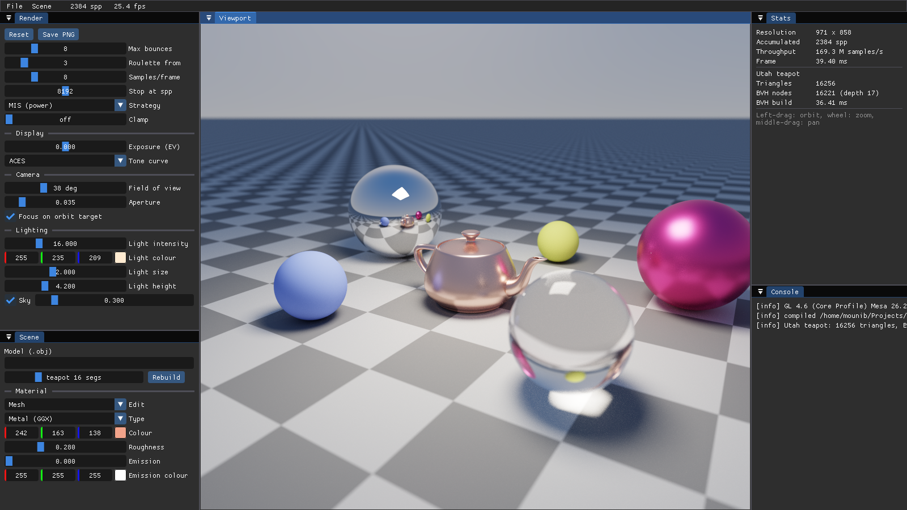

# Path tracer measurements

Every number on this page comes from a run of the programs in this repository; the commands are
given so they can be repeated. Nothing is estimated.

**Machine**: AMD Radeon RX 580 (Polaris 10, 8 GB) with Mesa 26.2.2 radeonsi (ACO), OpenGL 4.6
core; AMD Ryzen 5 5600 for the CPU side. Release build (premake `optimize "Speed"`).
Linux 7.2, window hidden (`--hidden`), no vsync.

## Rendering throughput at 1280x720

```
./bin/Release/pathtracer --hidden --bench          # 10 s at 1280x720, prints a BENCH line
```

The benchmark renders the default scene (copper GGX teapot of 16 256 triangles, five spheres
including a mirror and a glass one, the checker ground, area light and sky; MIS, 8 bounces
maximum, Russian roulette from bounce 3, thin lens on). It runs 4 dispatches (4 spp) per frame,
then `glFinish` and reads back the GPU ray counter, so the per-frame synchronisation and the
ImGui frame are included in the time. The clock starts at the first dispatch.

A *sample* is one camera path for one pixel. A *ray* is one scene query, either a closest-hit
query (camera ray or bounce) or a shadow ray of next-event estimation; each one is tested
against the ground plane, the 5 spheres, the light and the mesh BVH. Rays are counted on the GPU
(per-workgroup sum in shared memory, then one `atomicAdd` per workgroup).

| Configuration | Run | spp after 10 s | Samples/s | MRays/s | Rays/sample | ms per spp |
| --- | --- | ---: | ---: | ---: | ---: | ---: |
| Default scene, 4 spp/frame | 1 | 1269 | 116.8 M | 397.0 | 3.40 | 7.89 |
| | 2 | 1261 | 116.0 M | 394.5 | 3.40 | 7.94 |
| | 3 | 1245 | 114.6 M | 389.5 | 3.40 | 8.04 |
| 1 spp/frame (`--spf 1`) | 1 | 535 | 49.3 M | 167.5 | 3.40 | 18.70 |
| | 2 | 542 | 49.9 M | 169.6 | 3.40 | 18.47 |
| | 3 | 554 | 51.0 M | 173.3 | 3.40 | 18.08 |
| Teapot at 64 segments, 261 632 triangles (`--segments 64`) | 1 | 949 | 87.2 M | 296.4 | 3.40 | 10.57 |
| | 2 | 921 | 83.7 M | 284.6 | 3.40 | 11.01 |
| | 3 | 921 | 84.7 M | 287.9 | 3.40 | 10.89 |
| BSDF sampling only, no shadow rays (`--strategy 0`) | 1 | 1593 | 145.5 M | 344.2 | 2.37 | 6.34 |
| | 2 | 1529 | 140.7 M | 332.9 | 2.37 | 6.55 |
| Sky off, area light only (`--no-sky`) | 1 | 1301 | 119.7 M | 406.9 | 3.40 | 7.70 |
| | 2 | 1293 | 119.0 M | 404.6 | 3.40 | 7.74 |

Reading the table:

- **About 1 250 spp in 10 s** at 1280x720 for the default scene, i.e. roughly 115 M samples/s and
  390 MRays/s.
- **The interactive preview** is the 1 spp/frame row: about 18.5 ms per frame including the
  forced synchronisation, so the noisy preview while orbiting runs above 50 frames per second
  at 720p. Throughput is lower than with 4 spp/frame because the GPU waits for the CPU between
  frames; batching dispatches keeps it busy.
- **16x more triangles cost about 36% more time per sample** (7.96 -> 10.82 ms per spp, means of 3 runs): the BVH
  makes the cost grow with tree depth (17 -> 22 levels), not with the triangle count.
- **NEE adds about one shadow ray per bounce** (2.37 -> 3.40 rays per sample) and costs ~23%
  more time per sample (6.4 -> 7.96 ms per spp), but buys far less noise per sample (see the strategy figure below).
- The ray count does not change with the sky switched off: the same seeds give the same paths;
  only the radiance they carry differs.

## BVH build time

Printed by the same `--bench` run (`BENCH bvh` lines): binned SAH with 16 bins, single thread,
median of 5 builds; each run of the benchmark repeats the measurement.

| Mesh | Triangles | Nodes | Depth | SAH cost | Build time (4 runs) |
| --- | ---: | ---: | ---: | ---: | --- |
| Utah teapot, 16 segments per patch | 16 256 | 16 221 | 17 | 26.30 | 13.1, 21.2, 24.8, 14.3 ms |
| Utah teapot, 64 segments per patch | 261 632 | 261 491 | 22 | 33.76 | 227.5, 279.8, 263.4, 251.7 ms |

The build is O(n log n): 16x the triangles took about 14x the time (medians of the four runs,
17.7 ms and 257.5 ms). The run-to-run spread is large for the short 16-segment build.

**SAH against median split** (`./bin/Release/tests`, `bvh_testSahBeatsMedian`, leaves of at most
4 triangles, cost = expected node visits + triangle tests for a random ray hitting the root):

| Scene | SAH cost | Median-split cost |
| --- | ---: | ---: |
| Utah teapot, 12 segments per patch | 24.69 | 35.50 |
| Random soup of 4 000 triangles | 75.41 | 98.75 |

## Convergence

```
./bin/Release/pathtracer --hidden --size 640x360 --spp N --spf 16 --render-shot cN.png
```


RMSE of the 8-bit tonemapped image against a 16 384 spp render of the same scene (ImageMagick
`compare -metric RMSE`, normalised to [0, 1]):

| spp | 1 | 4 | 16 | 64 | 256 | 1024 | 4096 |
| --- | ---: | ---: | ---: | ---: | ---: | ---: | ---: |
| RMSE | 0.1018 | 0.0561 | 0.0326 | 0.0203 | 0.0119 | 0.0068 | 0.0040 |
| ratio to previous | | 0.55 | 0.58 | 0.62 | 0.59 | 0.57 | 0.58 |

Theory predicts a ratio of 0.5 per 4x samples for the linear radiance (noise ∝ 1/√N). Measured
on tonemapped 8-bit images the ratio is about 0.57: the tone curve compresses bright noise more
than dark noise, quantisation and the reference's own noise put a floor under the error, and the
glass caustic contributes rare, very large samples (heavy tails converge more slowly in RMSE at
low N). The trend is still a straight line on a log-log plot: the error falls 25x over 4 096x the
samples.

## Sampling strategies at equal sample count

```
./bin/Release/pathtracer --hidden --size 640x360 --spp 64 --spf 16 --no-sky --strategy {0,1,2} --render-shot sK.png
```


Lit only by the area light, 64 spp each. All three estimators are unbiased: rendered to
2 048 spp at 320x180, the mean pixel value of the three images is 0.67214 (BSDF only), 0.67253
(NEE only) and 0.67254 (MIS), within 0.06% of each other, and the RMSE between the NEE and MIS
images is 0.0048 against 0.027 between BSDF-only and MIS (the BSDF-only image is still noisy).
At 64 spp BSDF sampling alone is unusable for a small light, NEE is clean on diffuse surfaces,
and MIS looks like NEE here: with a light this small, light sampling has the higher density
almost everywhere, so the power heuristic gives it nearly all the weight. MIS earns its keep in
the other regime (large lights seen in sharp glossy reflections), where NEE alone gets noisy and
the weight moves to BSDF sampling.

## Screenshot

```
./bin/Release/pathtracer --hidden --spf 8 --frames 300 --screenshot docs/assets/pathtracer.png
```


