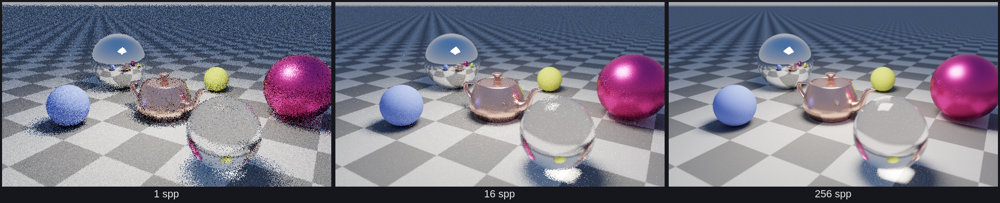
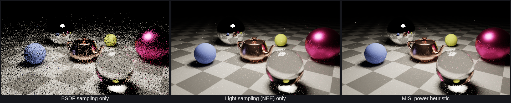

# Path tracing, from the rendering equation to the shader

This note explains what `apps/pathtracer` computes and why the picture gets cleaner the longer
you leave the camera still. Every formula below is the one the code uses; the shader is
[`assets/shaders/pt.comp`](../assets/shaders/pt.comp) and the BVH it walks is built by
[`engine/src/spatial/Bvh.cpp`](../engine/src/spatial/Bvh.cpp).



## 1. What a pixel measures

A camera pixel records **radiance** `L(x, ω)`: the power arriving at point `x` from direction
`ω`, per unit area and per unit solid angle. For the pixel we only need the radiance travelling
back along the camera ray. If that ray first hits a surface at `x`, the light leaving `x` towards
the camera (direction `ωo`) is given by the **rendering equation**:

```
L(x, ωo) = Le(x, ωo) + ∫_Ω f(x, ωi, ωo) · L(x', -ωi) · cos θi  dωi
```

- `Le` is the light the surface emits itself (zero except on lights and emissive materials).
- The integral runs over the hemisphere `Ω` of incoming directions `ωi` above the surface.
- `f` is the **BSDF**: how much of the light arriving from `ωi` is scattered towards `ωo`.
- `L(x', -ωi)` is the radiance leaving the next surface `x'` seen from `x` in direction `ωi`.
  It is given by the same equation, so the equation is recursive.
- `cos θi = n · ωi` accounts for light arriving at a grazing angle spreading over a larger area.

The recursion is the whole difficulty: the light at one point depends on the light at every
other point. There is no closed form for a real scene, but there is a very good way to estimate
an integral you cannot solve: random sampling.

## 2. The Monte Carlo estimator

To estimate `I = ∫ g(ω) dω`, draw a random direction `ω` with probability density `p(ω)` and
evaluate

```
Î = g(ω) / p(ω)
```

Its expected value is `∫ g(ω)/p(ω) · p(ω) dω = I`, for any `p` that is non-zero wherever `g`
is. One sample is an **unbiased** but noisy guess. Apply it to the rendering equation with a
single sampled direction per bounce and you get one **path**:

```
L ≈ Le(x0) + f0 cos0 / p0 · [ Le(x1) + f1 cos1 / p1 · [ Le(x2) + ... ] ]
```

The shader keeps the running product in a variable called the **throughput**
`T = Π fk cos θk / pk`, and adds `T · Le` every time the path meets emitted light. That is the
`for` loop in `radiance()`; `T *= weight` with `weight = f cos / p` is the only place the
throughput changes (apart from Russian roulette, below).

The camera ray itself is also random: the sample position inside the pixel is jittered
(`(px + rnd2()) / resolution`), which turns the pixel's area integral into the same kind of
estimate and gives antialiasing for free. With a thin lens (section 7) the point on the lens is
random too, which adds depth of field.

## 3. Why accumulation converges: variance falls as 1/N

Every dispatch of the compute shader traces one independent path per pixel and **adds** its
radiance to an `RGBA32F` image; the alpha channel counts the samples. The display pass shows

```
L̄N = (1/N) Σ_{k=1..N} Lk          (rgb / a in pt_display.frag)
```

The samples `Lk` are independent and identically distributed with mean `L` and variance `σ²`.
The mean of N of them still has expected value `L`, and since the variance of a sum of
independent variables is the sum of the variances,

```
Var[L̄N] = (1/N²) · N σ² = σ² / N          standard deviation (visible noise) = σ / √N
```

Four times more samples halve the noise. That is what the convergence figure shows. The
measured error against a 16 384 spp reference in
[pathtracer-benchmarks.md](pathtracer-benchmarks.md) drops by about 0.57 per 4x samples rather
than exactly 0.5, because it is measured on 8-bit tonemapped images (the tone curve compresses
bright noise, quantisation adds a floor) and rare caustic paths make the error heavy-tailed. It also explains the interaction design: any change of camera or
parameter makes the old samples estimates of a *different* integral, so the image is cleared
(`spp_ = 0`, and the shader overwrites instead of adding when `uFrame == 0`). While you drag
the camera you see the 1-sample estimate; when you stop, `N` grows and the noise melts. Exposure
and the tone curve are applied after the average, so changing them does not restart anything.

The only lever besides `N` is `σ²`, the variance of a single sample. The rest of this note is
about making `σ²` small without changing the mean.

## 4. Importance sampling: choosing p

The estimator is unbiased for any valid `p`, but its variance depends a lot on the choice. If
`p` were exactly proportional to the integrand `g`, every sample would return the same value and
the variance would be zero. We cannot do that for the full integrand (we do not know `L`), but we
can make `p` follow the parts we know: the BSDF and the cosine.

**Lambertian (diffuse).** `f = albedo / π`. Sampling directions with `p(ωi) = cos θi / π`
(cosine-weighted hemisphere, generated as `r = √u1, φ = 2π u2, z = √(1 − u1)`) gives

```
weight = f cos / p = (albedo/π) · cos θi / (cos θi / π) = albedo
```

The cosine and the `1/π` cancel, so a diffuse bounce simply multiplies the throughput by the
albedo.

**Metal (GGX microfacets).** A rough metal is modelled as many tiny mirrors whose normals `h`
follow the GGX distribution with `α = roughness²`:

```
D(h) = α² / (π ((n·h)² (α² − 1) + 1)²)
G1(v) = 2 (n·v) / ((n·v) + √(α² + (1 − α²)(n·v)²))          G = G1(ωi) G1(ωo)
F(ωo·h) = F0 + (1 − F0)(1 − ωo·h)⁵                          F0 = metal colour (Schlick)
f(ωi, ωo) = D G F / (4 (n·ωi)(n·ωo))
```

The shader samples `h` with density `D(h)(n·h)` (`cos θh = √((1 − u1)/(1 + (α² − 1)u1))`) and
reflects `ωo` about it. Changing variables from `h` to `ωi` multiplies the density by
`1/(4 ωo·h)`, so

```
p(ωi) = D (n·h) / (4 (ωo·h))
weight = f cos θi / p = F · G · (ωo·h) / ((n·ωo)(n·h))
```

Below a roughness of 0.03 the lobe is treated as a perfect mirror: `ωi = reflect(−ωo, n)`,
weight `F`.

**Glass (smooth dielectric).** A perfect interface either reflects or refracts. The shader
computes the exact unpolarised Fresnel reflectance

```
η = n1/n2,  cos θt = √(1 − η² (1 − cos² θi))
rs = (η cos θi − cos θt)/(η cos θi + cos θt),   rp = (cos θi − η cos θt)/(cos θi + η cos θt)
F = (rs² + rp²) / 2         (F = 1 under total internal reflection)
```

and **chooses** reflection with probability `F`, refraction with probability `1 − F`. The
reflected light carries a factor `F` and is chosen with probability `F`, so the weight is 1; the
refracted direction `ωt = −η ωo + (η cos θi − cos θt) n` likewise gets weight 1 (times the glass
tint). Choosing between lobes in proportion to their contribution is importance sampling too.

Mirrors and glass are **delta** distributions: only one exact direction contributes. They can
only be handled by BSDF sampling, which matters for the next section.

## 5. Next-event estimation: sampling the light

BSDF sampling is a poor strategy for small bright lights: a diffuse bounce sends its ray in a
random direction, and only the rare ray that happens to hit the light brings back energy. Those
rare, huge contributions are the noise (and the white specks called fireflies).

**Next-event estimation (NEE)** instead picks a point `y` on the light directly, uniformly over
its area `A`, so `pA(y) = 1/A`. The rendering equation is an integral over directions; to use an
area density we convert it with the geometry of the two points:

```
dω = cos θl / d² dA          =>     p_light(ωi) = d² / (cos θl · A)
```

where `d = |y − x|` and `cos θl` is the cosine at the light between its normal and the direction
back to `x`. One shadow ray tests visibility, and the contribution is

```
T · f(ωi, ωo) cos θi · Le / p_light(ωi)        if y is visible from x
```

This is `lightPdf = d2 / (cosL * lightArea)` in the shader. For diffuse surfaces it is
dramatically less noisy than BSDF sampling. It has its own weak spot: on a glossy surface
facing a large light, the BSDF lobe is narrow and most light samples fall where `f ≈ 0`, while
the rare ones in the lobe are very large.

## 6. Multiple importance sampling

Neither strategy is best everywhere, and using both naively would count the light twice. **MIS**
(Veach) combines them: every way of generating the same path gets a weight, and the weights sum
to one for each path, so the combination stays unbiased. With one sample from each strategy the
**power heuristic** (β = 2) gives the weight of a sample generated by strategy `s`:

```
w_s = p_s² / (p_light² + p_bsdf²)
```

The shader applies it in two places:

1. **NEE sample** (shadow ray towards the light):
   `w = lightPdf² / (lightPdf² + bsdfPdf²)`, where `bsdfPdf` is the density with which the BSDF
   sampler *would* have chosen that direction (`evalBsdf` returns it).
2. **BSDF sample that hits the light**: `w = prevPdf² / (prevPdf² + lightPdf²)`, where `prevPdf`
   is the density of the bounce that produced the ray and `lightPdf = t² / (cos θl · A)` is
   computed at the point that was hit.

Where one density dominates, its weight goes to 1 and the other strategy's noisy samples are
weighted down to almost nothing. Delta bounces (mirror, glass) cannot be light-sampled, so a
light reached right after one counts fully (`prevDelta`), and so does a light seen directly by
the camera. The render panel has a *Strategy* combo to switch between BSDF only, NEE only
and MIS; all three converge to the same image (the measured means agree to 0.06%), but at equal
sample counts the noise is very different:



The sky is not light-sampled: it is broad and dim, so BSDF sampling handles it well, and paths
that escape simply add `T · sky(ω)`. Emissive materials on the mesh are also reached by BSDF
sampling only, with full weight.

## 7. The camera: thin lens and depth of field

A pinhole camera sends every ray through one point and everything is sharp. A real lens has an
aperture of radius `r`. The thin-lens model keeps one plane at distance `dfocus` sharp: the
pinhole ray through the pixel meets that plane at

```
P = eye + dir · dfocus / (dir · forward)
```

and the actual ray starts at a random point of the lens disc, `eye + right · ρ cos φ + up · ρ sin φ`
with `ρ = r√u1` (uniform on the disc), and goes towards `P`. Points on the focus plane receive
rays from every lens position at the same pixel and stay sharp; points off it are spread over a
disc that grows with the aperture: that is depth of field, and it costs nothing extra because
the averaging is already there. By default the focus distance follows the orbit target.

## 8. Russian roulette: unbiased path termination

Paths could bounce forever. Cutting them at a fixed depth loses energy (bias). After `uRRStart`
bounces the shader instead continues with probability

```
q = clamp(max(T.r, T.g, T.b), 0.05, 0.95)
```

and divides the throughput by `q` if the path survives. The expected value is unchanged:
`q · (T/q) · L + (1 − q) · 0 = T · L`. Dim paths, which contribute little, are killed often;
bright ones survive. The *Max bounces* slider is still a hard limit (8 by default), which is a
small, intentional bias in scenes with many inter-reflections.

## 9. Random numbers

Each pixel needs a stream of numbers that differs between pixels and between samples, with no
state stored between dispatches. The shader hashes the pixel index and the sample index with the
PCG hash

```
state = v · 747796405 + 2891336453
word  = ((state >> ((state >> 28) + 4)) ^ state) · 277803737
hash  = (word >> 22) ^ word
seed  = pcg(pixelIndex ^ pcg(seed + frame · 0x9E3779B9))
```

then calls the same hash on its own output for every new number, keeping the top 24 bits to get
a float in `[0, 1)`. Because the seed is deterministic, the same settings always produce the same
image, which is how the convergence figure was made.

## 10. Finding the first hit fast: the BVH

Each path segment asks "what is the closest surface along this ray?". The teapot has 16 256
triangles at the default tessellation; testing all of them per ray would be hopeless. The BVH
(bounding volume hierarchy) is a binary tree of boxes: if a ray misses a box it cannot hit
anything inside.

**Building it with the surface area heuristic.** For a random ray that hits a parent box, the
chance it also hits a child box is the ratio of their surface areas. The expected cost of
splitting a node into `L` and `R` is therefore

```
C = C_trav + C_isect · (A(L) · N(L) + A(R) · N(R)) / A(parent)
```

The builder drops every triangle's centroid into 16 bins per axis, sweeps the 15 planes between
bins from both sides to get `A` and `N` on each side in O(bins), keeps the cheapest plane, and
makes a leaf when `N · C_isect` (testing everything) is cheaper. The tests check that this tree
has a lower total SAH cost than splitting at the median centroid (24.7 vs 35.5 for the teapot).

**Flattening.** Nodes are written depth first into one array of 32-byte records
`{ vec3 lo; uint leftOrFirst; vec3 hi; uint count; }`, the left child right after its parent,
`leftOrFirst` holding the right child (interior) or the first triangle (leaf, `count > 0`). The
array goes straight into a shader storage buffer; triangles are reordered so each leaf's are
contiguous, and stored as `v0, e1 = v1 − v0, e2 = v2 − v0` plus vertex normals.

**Traversal.** Both children are slab-tested; the nearer one is visited first and the farther
one pushed on a 32-entry stack, so a close hit shrinks `tmax` and lets the far box be skipped.
Leaves run the Möller–Trumbore ray-triangle test: solving `o + t d = v0 + u e1 + v e2` by
Cramer's rule,

```
p = d × e2,   det = e1 · p,   s = o − v0
u = (s · p)/det,   q = s × e1,   v = (d · q)/det,   t = (e2 · q)/det
hit if u ≥ 0, v ≥ 0, u + v ≤ 1, t in (ε, tmax)
```

The barycentrics `(u, v)` interpolate the vertex normals for smooth shading. Shadow rays use the
same walk but stop at the first hit. The CPU version of this traversal is checked against brute
force on thousands of random rays in `tests/test_bvh.cpp`.

## 11. Display

The display pass divides the sum by the count, multiplies by `2^EV` (exposure), applies a tone
curve to squeeze unbounded radiance into `[0, 1]`, and encodes to sRGB:

```
ACES fit:   c = x (2.51 x + 0.03) / (x (2.43 x + 0.59) + 0.14)
sRGB:       c ≤ 0.0031308 ? 12.92 c : 1.055 c^(1/2.4) − 0.055
```

The Hable filmic curve and a plain clamp are also available. Tone mapping happens after the
average on purpose: averaging tonemapped samples would not converge to the tonemapped mean.

## Summary of the integrator

```
for each pixel, every dispatch:
    ray  = thin-lens camera ray through a jittered point of the pixel
    T = 1, L = 0
    for depth = 0 .. maxBounces:
        hit = closest surface (ground, spheres, light, mesh BVH)
        miss            -> L += T · sky(ω); stop
        light           -> L += T · Le · w_MIS(prevPdf, lightPdf); stop
        L += T · emission
        non-delta BSDF  -> L += T · f cos · Le / lightPdf · w_MIS(lightPdf, bsdfPdf)   (shadow ray)
        sample ωi from the BSDF, T *= f cos / p
        after uRRStart bounces: survive with q, T /= q
    accum += (L, 1)
```
