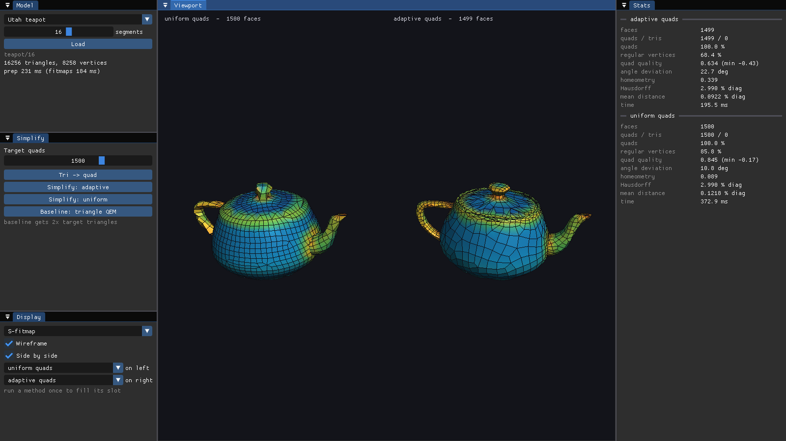

# Quad meshes: from triangles to an adaptive quad layout

This note walks through everything behind `apps/quadmesh`: the half-edge structure the
operators edit, the discrete curvature used for display, the conversion of a triangle mesh
into quads, and the simplification of that quad mesh, first uniformly and then adaptively.
Code lives in `engine/src/geometry/`; numbers are in [quadmesh-benchmarks.md](quadmesh-benchmarks.md).


## 1. Why quads, and why simplifying them is different

Triangle simplification has one goal: approximate the shape with as few triangles as
possible. Garland and Heckbert's quadric error metric (QEM) does that very well, and we keep
it as the baseline. A quad mesh is judged by different criteria. Subdivision surfaces, finite
elements and texture layout want faces that are:

* **flat and square**: corner angles near 90 degrees, sides of similar length;
* **regular**: most interior vertices have valence 4 (3 on a straight boundary);
* **evenly sized**: or, for the adaptive version, sized by how much detail the surface has
  locally.

The first and third goals together are called *homeometry*. With `mu = sqrt(area / #quads)`,
the side of an ideal square, the energy

    E = sum over edges (|e| - mu)^2  +  sum over quad diagonals (|d| - sqrt(2) mu)^2

is zero exactly when every face is a square of side `mu`. `homeometryEnergy()` reports E
divided by the number of terms and by `mu^2`, so the number does not depend on scale.

The method here follows Pietroni et al. (2010) for the uniform case and Bozzo et al. (2010)
for the adaptive one. It only uses **local operators** that keep the mesh made of quads, plus
a **local smoothing** that keeps vertices on the input surface. No parametrization, no global
solve.

## 2. The half-edge mesh (`HalfEdgeMesh.h`)

Every operator below rewires a few pointers, so the data structure matters.

```
            v_to
             ^  \
     next(h) |   \  h's twin goes the other way and belongs to the face on the right
             |    \
   face(h) <-+  h  v
             |    /
      prev(h)|   /
             |  /
            v_from
```

* Edges own two half-edges stored side by side: `twin(h) = h ^ 1`, `edge(h) = h / 2`. No twin
  pointer can go stale.
* A half-edge stores the vertex it leaves, its face, `next` and `prev`.
* Holes are **boundary loops**: half-edges with `face = -1` linked into cycles like faces.
  Walking around a boundary vertex therefore never falls off the mesh, and a boundary vertex
  stores its outgoing boundary half-edge so that a rotation starts and ends there.

`validate()` checks the invariants every operator must keep:

| invariant | why it matters |
|---|---|
| `next(prev(h)) = h`, `twin(twin(h)) = h`, `from(next(h)) = to(h)` | loops are well formed |
| loops have >= 3 sides and never repeat a vertex | no degenerate or folded face |
| the half-edges leaving a vertex form one fan | manifold vertex (no bow-tie) |
| at most one edge per vertex pair | manifold edge, no duplicate |
| a boundary vertex stores its boundary half-edge | rotation convention |

Building from a polygon soup (`fromPolygons`) does three repairs before linking:
re-orients faces by a breadth-first search (two faces agree when they walk their shared edge
in opposite directions; a contradiction means the surface cannot be oriented, e.g. a Moebius
strip), skips faces that would put a third face on an edge, and splits *bow-tie* vertices
(several fans touching at one point) into one copy per fan. The Euler characteristic
`chi = V - E + F` and the identity `chi = 2c - 2g - b` (components, genus, boundary loops)
are checked by the tests on the teapot and on spheres.

### Operators

All of them either keep every invariant or refuse to act (`canX()` first):

* **Edge collapse** `u -> v` (any polygon). A triangle on either side vanishes and its two
  other edges are glued into one; a larger face simply loses the corner `u`. The refusal rules
  are the *link condition* generalised to polygons: the common neighbours of `u` and `v` must
  be exactly the apexes of the vanishing triangles (otherwise two edges would merge into a
  duplicate), no other face may contain both `u` and `v` (it would fold), two boundary vertices
  joined by an interior edge may not merge (it would pinch the surface), a boundary hole of 3
  edges may not shrink to 2, and an apex may not drop to valence 2.
* **Edge flip** for two triangles, **face split** (insert a diagonal) and **face join**
  (remove an edge between two faces that share only it).
* **Diagonal collapse** of quad `(a, b, c, d)`: merge `a` and `c`. Implemented as a split
  along `a-c` followed by the collapse of that new edge, which glues `ab` onto `cb` and `ad`
  onto `cd`. The quad disappears together with one vertex and two edges; neighbouring quads
  stay quads. `b` and `d` lose one edge each.

```
     d ----- c                 d
     |       |                / \
     |   q   |      ->       / w \        (a and c merged into w)
     |       |               \   /
     a ----- b                \ /
                               b
```

* **Edge rotation**: two quads sharing an edge form a hexagon `v x1 x2 u y1 y2`; the shared
  diagonal `v-u` is replaced by `x1-y1` (one step one way) or `x2-y2` (the other way). Face
  and vertex counts do not change, only valences: `u` and `v` lose one, the new end points gain
  one.
* **Doublet removal**: an interior vertex of valence 2 sits between two faces that share two
  consecutive edges. Dissolve both edges and the vertex; two quads become one quad.
* **Singlet removal**: a vertex of valence 1 hangs inside a folded face. Remove the dangling
  edge; if the face is left with two sides, replace it by a single edge.

The tests run thousands of random collapses, flips, rotations and diagonal collapses and
validate the mesh after each one; chi never changes.

## 3. Discrete differential geometry (`Differential.h`)

Used for the curvature view and as general tooling (Meyer, Desbrun, Schroeder and Barr, 2003).

* **Normals**: face normals from the Newell sum (works for non-planar polygons); vertex normals
  weight each face by its corner angle at the vertex, so the result does not depend on how a
  fan is triangulated.
* **Cotangent Laplacian**: for edge `ij` with opposite angles `alpha`, `beta`,
  `w_ij = (cot alpha + cot beta) / 2`. It is the discrete Laplace-Beltrami operator.
* **Mixed Voronoi area** `A_i`: in a non-obtuse triangle, the Voronoi region of the corner,
  `(|PR|^2 cot Q + |PQ|^2 cot R) / 8`; in an obtuse triangle, half the area to the obtuse
  corner and a quarter to the others. The areas tile the surface exactly.
* **Mean curvature normal** `K(x_i) = 1/(2 A_i) sum_j (cot alpha_ij + cot beta_ij)(x_i - x_j) = 2 H n`.
  On a sphere of radius R the tests get `H = 1/R` within 1%.
* **Gaussian curvature** by angle defect, `K_i = (2 pi - sum of angles) / A_i`. On the boundary
  the defect is `pi - sum`, the turning angle of the boundary curve, so that the sum over all
  vertices is `2 pi chi` on any mesh (discrete Gauss-Bonnet), which the tests check on spheres,
  the open teapot, the teapot with holes filled and a flat square.
* **Smoothing**: explicit uniform Laplacian (moves vertices towards the neighbour average and
  also slides them tangentially) and cotan Laplacian (mean-curvature flow, mostly along the
  normal).

## 4. Triangles to quads (`QuadMesh.h`)

The simplifier works on quads, so the input triangle mesh is converted first, with two
constraints: keep every input vertex, and do not increase the face count. One step of
Catmull-Clark gives all quads too, but triples the face count and makes every original vertex
irregular.

**Pairing.** Two triangles sharing an edge form a candidate quad `(a, d, b, c)`. Each
interior edge gets a squareness score from the four normalized sides of that quad: we use
`1 - mean |cos(corner angle)|`, which is 1 for any rectangle. (Pietroni et al. phrase it as
the sum of pairwise dot products of the normalized edges; the products between *adjacent*
edges are the corner cosines, which is what we keep, in absolute value so that 90 degrees is
best.) Edges are visited from best to worst; an edge is *flagged* if neither of its triangles
already has a flagged edge. At most one flagged edge per triangle means every triangle joins at
most one quad, so removing the flagged edges gives a valid quad-dominant mesh. Nearly folded
candidates are skipped.

**Crawling.** A few triangles remain, usually far apart. For each one, a breadth-first search
over faces finds the nearest other triangle. Along the path, the triangle swaps places with
every quad it crosses: triangle + quad = pentagon, which is re-split by one diagonal so that
the triangle now touches the next face of the path (of the two possible diagonals the one
leaving the squarer quad is used). When the two triangles touch, they merge into a quad.
Each step moves one diagonal; vertices and face count are unchanged. A closed surface always
has an even number of triangles (`3F = 2E`), so closed components become pure quad meshes.

On the teapot at 16 segments, pairing makes 8065 quads, crawling 63 more, and the result is
100% quads with 96.8% regular vertices.

## 5. Uniform simplification

```
M  = input triangles      ReferenceSurface: grid over M for closest points
M0 = trianglesToQuads(M)  Q = heap of quads keyed by their shortest diagonal
while #quads > target:
    q = pop(Q)                                 (skip stale entries)
    diagonal-collapse q along its shorter diagonal; new vertex = midpoint projected on M
    clean: remove doublets / singlets around the collapse (repeat while new ones appear)
    rotate every edge around the new vertex whose rotation lowers the valence energy
    relax the vertices of the faces around the new vertex, project them on M
    re-key the quads touching any moved vertex
final: a few global relaxation passes
```

**Why shortest diagonal first.** A collapse makes the neighbours grow. Always removing the
shortest diagonal eliminates the elements that are too small, so the survivors converge to a
common size, the same way a shortest-edge-first triangle decimation equalises edges.

**Valence energy of a rotation.** For the six hexagon vertices,
`sum |D(v_i) - ideal_i|` with ideal 4 inside and 3 on the boundary. A rotation changes four
valences by +-1; it is applied when the energy strictly drops (best direction first) and both
new quads are convex. Rotations shorten long edges; collapses remove short ones.

**Tangent-space relaxation.** Each vertex is pulled by springs towards its neighbours: rest
length `mu` along edges and `sqrt(2) mu` along quad diagonals. Its rest position is the
average over springs of `x_j + L (x_i - x_j)/|x_i - x_j|`. The move is restricted to the
tangent plane (the input normal at the vertex), damped by `lambda = 0.5`, and the result is
projected back on M (closest point through the grid). A move is kept when no face around the
vertex turns over and its worst corner stays reasonable or improves. Relaxation both improves
the faces directly and makes the heap keys meaningful: a quad that stays small after
relaxation is a good candidate for the next collapse.

**Geometric guard on collapses.** A collapse is refused if a face around `a` or `c` would turn
its normal by more than 90 degrees or vanish. Concave quads are *allowed* at this point. In
a strip of thin quads, collapsing any diagonal briefly makes neighbours concave; forbidding
it froze whole strips of the teapot body (quality 0.34, angle deviation 26 degrees at 1000
quads), allowing it lets the relaxation straighten them (quality 0.75, 15.6 degrees).

**Spatial index.** Every projection is a closest-point query on the input triangles. A
uniform grid with about 0.15 triangles per cell stores each triangle in the cells its box
overlaps; a query visits growing cubic shells of cells around the point and stops when the
best distance is shorter than the distance to the outside of the visited block. It is exact
(the tests compare it with brute force) and takes a handful of triangle tests per query
because the queried points are on or very near the surface.

## 6. Adaptive simplification: fitmaps

A uniform layout spends as many quads on a flat panel as on a sharp feature. The adaptive
version adds two scalar fields computed once on the input (Panozzo et al. 2011; Bozzo et al.
2010).

**S-fitmap (scale).** Around a vertex `v`, fit a plane by least squares to the points within
radius `r` and record the RMS distance `E(r)`. For radii from `r_0` = mean edge length to
`r_h` = bounding-box radius on a geometric scale (`h = 8`), a smooth surface gives
`E(r) ~ a r^2` with `a` proportional to curvature. `F_s(v) = sqrt(a)`.

* The plane fit is the smallest eigenvalue of the covariance of the neighbours (total least
  squares); it *is* the mean squared distance to the best plane. A 3x3 Jacobi solver gives it.
* All radii are done in one pass per vertex: each neighbour falls in the first radius bucket
  that contains it, moments (count, sum of positions, sum of outer products, sum of normals)
  are accumulated per bucket and prefix-summed.
* `a` is the mean of `E(r_k)/r_k^2` over the radii up to the M-fitmap radius (plain least
  squares on `E = a r^2` is dominated by the largest radius and returned nearly the same `a`
  everywhere).
* Neighbourhoods come from a uniform subsample of at most 4000 vertices; the work is split
  over threads. About 0.2 s for 10k vertices.

**M-fitmap (maximal radius).** At each radius, count the neighbours whose normal points
against the fitted plane normal (plane normal oriented by the sum of normals). `F_m(v)` is the
largest radius at which that fraction stays under `tau = 5%`: up to that radius the surface is a
height field over the plane, i.e. projectable. (We count vertices with their normals as
samples rather than faces.)

**Priority.** A quad is keyed by `|d| * (F_s(phi(c)) + b)` where `phi(c)` is the projection of
its centre on M. Corners already lie on M with their fitmap values cached, so `F_s(phi(c))` is
taken as the mean of the corner values, the linear interpolation over the face (projecting the
centre explicitly was tried: no better on the test models and 1.6x slower). `b = 0.15 *
mean(F_s)` keeps flat areas (`F_s = 0`) ordered by size instead of all tying at zero.

**Projectability gate.** A collapse is performed only if the radius of the selected face
(largest centre-to-corner distance) is at most `F_m` at its centre (smallest value over the
centre and corners): the face must fit inside the region where the input is still a height
field. (The condition is sometimes stated the other way round; read literally it would forbid
small faces and allow huge ones, which defeats its purpose.) If every remaining candidate is
blocked before the target is reached, the radius test is widened by 1.5x and all quads are
offered again (`gateRelaxations` in the stats), so the requested count is always met.

**Graded relaxation.** With the priority `|d| (S + b)`, collapses stop where
`|d| (S + b)` is about the same everywhere, i.e. where the ideal side is
`L(x) = k / (S(x) + b)`. Choosing `k` so that these ideal squares tile the surface with the
current number of quads, `#quads = integral (S + b)^2 dA / k^2`, gives a sizing field. Each
spring then uses the mean of `L` at its two ends instead of the global `mu`. Without it,
relaxation pulls everything back towards uniform sizes and undoes the adaptivity; using a
plain local average edge length instead was measurably worse (quality 0.505 vs 0.562, mean
error +20% on the teapot at 1000 quads).



## 7. Invariants of the whole loop

After every iteration of the simplifier:

1. the half-edge mesh validates (manifold, oriented, one edge per vertex pair, loops >= 3);
2. Euler characteristic, number of components and number of boundary loops are unchanged:
   every operator is a local change of topology that preserves them;
3. boundary vertices never move and are never removed (a diagonal collapse with one boundary
   corner keeps that corner; with two it is refused);
4. every vertex lies on the input surface (new and relaxed positions are projected);
5. no face around a collapse turns its normal by more than 90 degrees, no relaxation move turns
   one by more than about 72 degrees.

`geo_quadSimplifyInvariants` checks 1 to 4 on the teapot for both versions.

## 8. The baseline: triangle QEM (Garland and Heckbert 1997)

Each vertex accumulates `Q = sum over its faces of area * p p^T`, with `p = (n, d)` the face's
plane: `v^T Q v` is the area-weighted sum of squared distances from `v` to those planes.
Boundary edges add a heavily weighted plane through the edge and perpendicular to its face,
which keeps the outline. Edges sit in a heap keyed by `min v^T (Q_u + Q_v) v`, the minimiser
from a 3x3 solve (or the best of the end points and midpoint if singular). A collapse is
refused by the link condition or if a surviving triangle would turn its normal by more than
about 78 degrees; the survivor's quadric is `Q_u + Q_v`.

For a fair budget the baseline gets **two triangles per target quad** (same vertex count).

## 9. What the measurements say

Details in [quadmesh-benchmarks.md](quadmesh-benchmarks.md). In short:

* The triangle QEM baseline has a 2.7x to over 50x smaller mean distance for the same vertex budget.
  That is expected: it minimises distance and nothing else, its triangles are free to be
  slivers and to take any valence. The quad methods trade accuracy for structure: 100% quads,
  55 to 91% regular vertices, mean quad quality 0.33 to 0.90.
* Adaptive vs uniform at equal quad count: on the rounded box (flat panels, rounded edges)
  the adaptive version has 21 to 47% lower Hausdorff error and 33 to 36% lower mean error; on
  the bumpy sphere at 2000 quads the Hausdorff error drops from 1.39% to 0.34% of the diagonal
  (at 800 quads it is worse, 2.47% vs 1.90%: the sharpest bump is thinner than the faces both
  versions can afford there). The price is regularity and squareness: grading sizes needs more
  valence 3 and 5 vertices.
* On the open teapot, adaptivity helps at moderate reduction (mean error -35% at 1000 quads
  from 2016) but hurts at aggressive targets. Two reasons: boundary loops keep all their
  vertices, which pins fine faces along six borders, and the flat bottom (`F_s = 0`) grows huge
  faces. See the limitations.

## 10. Limitations and possible extensions

* **Boundaries are frozen.** There is no quad operator here that removes a boundary vertex
  while keeping quads, so open meshes keep their full boundary resolution.
* **Sharp creases are not detected.** The fitmaps see a crease as high curvature (more quads)
  but nothing aligns edges with it.
* **S-fitmap is mild.** `F_s = sqrt(a)` compresses the dynamic range: on the bump sphere the
  bump's `F_s` is only 2x the sphere's, so faces there end up about 2.5x smaller in area, not
  more.
* Projection is closest point, not a ray along the normal. Near places where two sheets come
  close (the teapot handle meets the body), a vertex could snap to the other sheet; the
  relaxation guard rejects moves that flip faces, which has been enough in practice.
* The global relaxation at the end is a fixed small number of passes, not iterated to
  convergence.

## References

1. N. Pietroni, P. Cignoni, D. Panozzo, E. Puppo. *Practical quad mesh simplification*.
   Computer Graphics Forum 29(2), 407-418, 2010.
2. A. Bozzo, D. Panozzo, E. Puppo, N. Pietroni, L. Rocca. *Adaptive quad mesh simplification*.
   Eurographics Italian Chapter Conference, 95-102, 2010.
3. D. Panozzo, E. Puppo, M. Tarini, N. Pietroni, P. Cignoni. *Automatic construction of
   quad-based subdivision surfaces using fitmaps*. IEEE TVCG 17(10), 1510-1520, 2011.
4. D. Bommes, B. Levy, N. Pietroni, E. Puppo, C. Silva, M. Tarini, D. Zorin. *State of the art
   in quad meshing*. Eurographics STARs, 2012.
5. M. Garland, P. Heckbert. *Surface simplification using quadric error metrics*. SIGGRAPH 1997.
6. M. Meyer, M. Desbrun, P. Schroeder, A. Barr. *Discrete differential-geometry operators for
   triangulated 2-manifolds*. Visualization and Mathematics III, 2003.
7. C. Ericson. *Real-Time Collision Detection*, section 5.1.5 (closest point on a triangle).
   Morgan Kaufmann, 2005.
