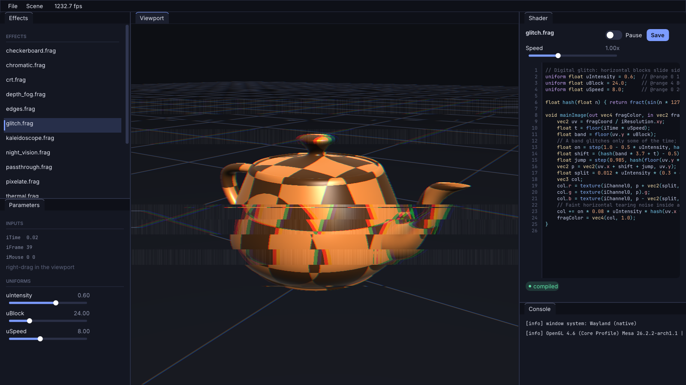

# The interface: theme, fonts and the GLSL editor

Everything lives in `engine/src/ui/`, installed once by `Application::run()`, so every app gets it.
It is a style layer on top of Dear ImGui: no fork, no patched ImGui sources.

## 1. The look (`Theme.cpp`, `ui::install`)

| Decision | How |
|---|---|
| **Fonts** | Inter (UI) and JetBrains Mono (code), both SIL OFL, in `assets/fonts/`. They are loaded with `io.Fonts->AddFontFromFileTTF`; the path comes from `assetsDir()`. If a file is missing the default ImGui font is used. `$GLUE_UI_SCALE` scales fonts and spacing for high-DPI screens. |
| **Palette** | One struct, `ui::Palette`: four surface levels (`bg0..bg3`), a hairline `border`, three text levels, one accent (periwinkle `#7C9CFF`) with hover, active and soft tints, and three status colours. Every ImGui colour slot is mapped from it, so changing the brand colour is one line. |
| **Geometry** | Large radii (windows 10, controls 7), roomy padding (frame 10 x 6, items 10 x 8), borders off on controls, a thin 11 px scrollbar. Rounded geometry is what makes ImGui stop looking like a debug tool. |
| **Depth** | Surfaces get lighter as they come forward: the dock background is darkest, panels are one step lighter, controls another. No shadows, no gradients: contrast between neighbours carries the hierarchy. |
| **Tabs** | The selected tab has an accent overline instead of a filled block. |

## 2. Controls

All are normal widgets built from `ImGui::ItemAdd`, `ButtonBehavior` and the window draw list, so they
take part in layout, focus and hit-testing like any other ImGui control.

- `ui::toggle(label, &bool)`: an animated switch. The animation value is kept in ImGui's state storage
  (`GetStateStorage`), keyed by the widget id, and eased toward the target every frame.
- `ui::slider(label, &float, lo, hi, fmt)`: label left, value right, a thin track and a round knob that
  grows when hovered. Dragging maps the mouse x to the value; it uses `CalcItemWidth()` so
  `SetNextItemWidth` works.
- `ui::accentButton`, `ui::chip` (status pill), `ui::sectionHeader` (small upper-case title + hairline),
  `ui::listRow` (selectable with an accent bar).

## 3. GLSL syntax highlighting (`GlslEditor.cpp`)

ImGui's `InputTextMultiline` handles caret, selection, clipboard, undo and scrolling, but draws one
colour. Rewriting a text editor was not the goal, so the highlighted text is painted *over* ImGui's:

1. `InputTextMultiline` is called with the text colour set to fully transparent. Everything about the
   editing still works; only its glyphs are invisible. Frame padding is widened on the left to leave
   room for a gutter.
2. A small lexer (`GlslEditor::lex`) walks the string once and produces spans `{begin, end, kind}`:
   keywords, types, built-in functions, `gl_*` variables, numbers, comments, preprocessor lines,
   operators, user function calls and swizzles. Block comments are split per line so every span stays
   on one line. It is re-run only when the text changes.
3. The multiline field is a child window; its name is `"<parent>/<label>_<id>"`, so
   `ImGui::FindWindowByName` returns it. Its draw list is still open after `End`, so the highlighted
   text is appended to *its* draw list, clipped to its inner rectangle, which puts it above the
   (invisible) original and under nothing else.
4. Position: the first glyph is at `DC.CursorStartPos + FramePadding` (this is the same offset
   `InputTextEx` applies), line `n` is at `n * FontSize` below it, and a token starts at the
   *unrounded* width of the line prefix from `ImFont::CalcTextSizeA`. Using `ImGui::CalcTextSize` here
   is a trap: it rounds every piece up to a whole pixel, so the colours drift away from the real text
   after a few tokens.
5. The caret is drawn by hand from `ImGuiInputTextState` (cursor byte offset and the blink timer),
   because the real one uses the text colour and is invisible. Line numbers, the current-line tint and
   error-line tints (`setErrorLines`, fed from the driver log by `parseErrorLines`) are drawn the same
   way.

The colours are Catppuccin Mocha. To check the overlay lines up, temporarily set the text colour in
step 1 to a visible colour: the two layers must coincide.

## Limits

- No word wrap (long lines scroll horizontally), no code folding, no auto-indent or completion.
- Only some stock widgets are restyled: float sliders in the apps were switched to `ui::slider`,
  integer sliders and drags keep ImGui's own look (rounded and recoloured by the theme).
- The error-line parser knows the Mesa (`0:12(5)`) and NVIDIA (`0(12)`) log formats.
